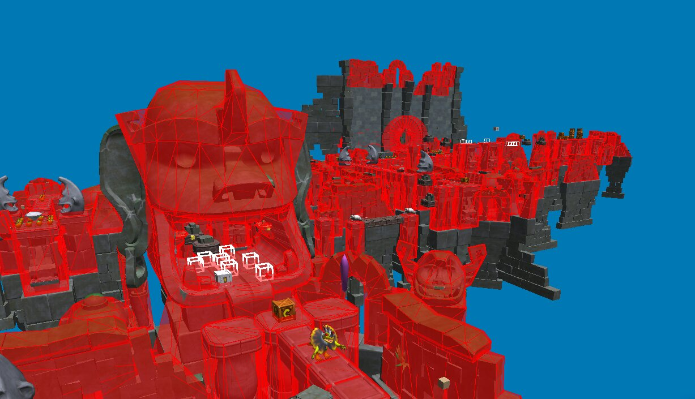
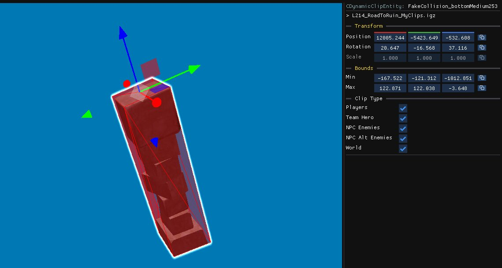
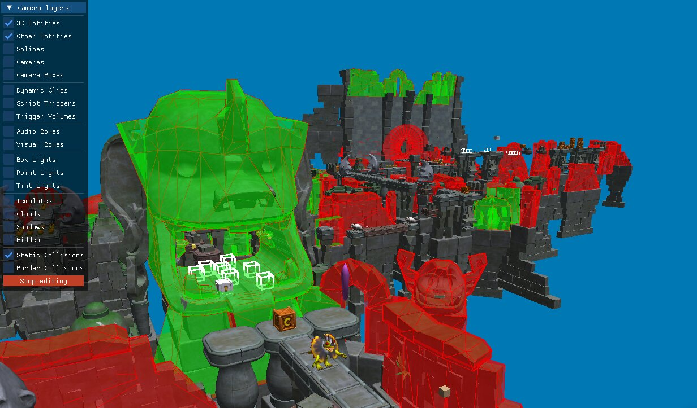

Collisions define which parts of a level Crash can stand on, walk into, or interact with.

## Types of collisions

| Type | Description                                                                                                                                                                                           |
| --- | --- |
| **Static collisions**  | Used by [static models](/level-editor/special-objects/static-models). They represent most of the level's collision geometry and are rebuilt whenever you save a level.                                |
| **Border collisions**  | Used by [border components](/level-editor/special-components/border-collisions). They define the level's boundaries and prevent Crash from going out of bounds.                                       |
| **Dynamic collisions** | Used by [enemies, platforms, hazards, and other dynamic objects](/level-editor/special-objects/spawner-templates). The game handles these automatically, so they don't require any special treatment. |
| **Dynamic clips**      | Box-shaped collision volumes that can interact with the player and/or enemies. They can be [created and edited manually](/level-editor/special-objects/dynamic-clips).      

## Viewing collisions

You can display **static and border collisions** by enabling their respective camera layers at the bottom of the [Camera Layers](/level-editor/object-tree-and-camera-layers/#camera-layers) panel.
You can also click on any collision to focus its parent object.

This can be useful to see where the actual collisions in a level are, as:

- Not all objects have collision data
- The collision data doesn't always match the visible geometry
- The collision data for an object can sometimes be defined in another object

## Creating collisions

If a [static model](/level-editor/special-objects/static-models) has no collision data, you can create a simple collision shape directly from the model.

1. Select the static model in the scene.
2. Choose **Create box collision**.
3. The editor creates a new [dynamic clip](/level-editor/special-objects/dynamic-clips) with the same position, size, and rotation as the selected shape.

This can be useful if you just want to add a simple box collision to a shape.

:::note
Proper collision rebuilding (creating a collision mesh with the exact shape of the object) is still a work in progress. Stay tuned for future updates!
:::

## Editing collisions

You can edit collision geometry when either the **Static Collision** or **Border Collision** camera layer is enabled.

### Entering edit mode

1. Enable the **Static Collision** or **Border Collision** camera layer.
2. Click **Edit Collisions** at the bottom of the camera layers.

> **Note:** If some collision geometry disappears when you enter edit mode, it means that geometry cannot be edited. This affects only a small number of objects, usually simple ones.

### Selecting collision faces

While in edit mode, you can select collision faces using the following controls:

- **Click** a face to select it.
- **Shift + click** to select additional faces.
- **Left-click and drag** to select multiple faces.

> **Tip:** Disable the **3D Entities** camera layer to make the collision mesh easier to see.

### Removing faces and exiting edit mode

- Press **Delete/Suppr** to remove the selected collision faces.
- Click **Stop Editing** to return to the regular editor.

## Debugging collisions

The collision debug views lets you inspect how static collision geometry is organized internally.

Open **Editor Settings → Debug Mode** and enable one of the following options:

- **Havok Objects**: Highlight objects that have static collision data.
- **Havok Sections:** Colors static collision triangles according to their BVH section index.
- **Havok Materials:** Colors static collision triangles according to their material index (dirt, ice...)